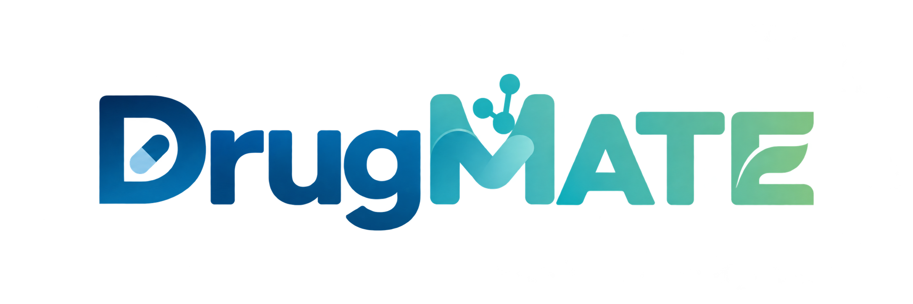

<p align="center">
  
</p>

<p align="center"><strong>A memory-augmented autonomous agent for structure-based drug discovery</strong></p>

DrugMATE is an autonomous agentic system for end-to-end structure-based drug
discovery (SBDD). It guides target-specific tool selection and parameter
configuration using an evolving memory of target–ligand experience profiles,
retrieved by embedding similarity. By combining autonomous workflow execution
with retrievable computational experience, DrugMATE supports evidence-guided
virtual screening and molecular design.

## Installation

### 1. Agent environment

From the repository root:

```bash
conda env create -f environment.yml
conda activate drugmate
python -m pip install -e '.[cli]'
python drugmate setup
python drugmate --cli
```

For later sessions, activate the environment and run `python drugmate --cli`.
The Python CLI needs no Node.js or scientific tools. Supply your own model
credentials through setup; private configuration stays under `~/.drugmate`
(or `DRUGMATE_HOME`).

The shipped [SOUL.md](SOUL.md) defines DrugMATE's fixed research persona.
Source checkouts and installed packages load their distributed copy; legacy
user/profile `SOUL.md` files do not replace it. Restart the CLI after a
maintainer changes the shipped persona. [AGENTS.md](AGENTS.md) governs source
maintenance rather than redefining that persona.

### 2. Minimal scientific tools

On Linux, start with **RDKit and Open Babel** in a separate environment. This
supports a first small task such as converting one SMILES molecule to a 3D SDF;
it does not require a GPU, model weights or the large memory downloads.
Run from the repository root:

```bash
conda create -n drugmate-science -c conda-forge python=3.11 rdkit openbabel
conda activate drugmate-science

export SBDD_ENV_DRUGMATE_PREFIX="$CONDA_PREFIX"
export SBDD_PYTHON="$CONDA_PREFIX/bin/python"
export BIO_SKILLS_ROOT="$PWD/skills/bio_research"
export SBDD_DATA_ROOT="$HOME/drugmate-runs"

conda activate drugmate
python drugmate --cli
```

These settings tell the agent where the scientific Python environment is and
where to write experiment outputs. Set them before each session, or save them
using the skill's [deployment reference](skills/bio_research/pipeline-entry/references/deployment.md#local-deployment-file).
Use either `SBDD_ENV_DRUGMATE_PREFIX` or `SBDD_ENV_DRUGMATE_NAME`, not both.

Some Open Babel builds need the bundled compatibility helper: a C++17 compiler,
Eigen 3 and matching Open Babel development headers/library are required if the
native coordinate-generation probe fails. See the
[adapter notes](skills/bio_research/input-normalization/scripts/openbabel_fast_compat/README.md).

**A complete docking run** needs additional preparation and docking tools. For
example, the Vina route needs Vina plus Meeko/RDKit and a supported final receptor
preparation backend. Install only the tools for your selected stages; see the
[full scientific tool list](docs/tools.md) for tools, environments and model
requirements. The [pipeline skill](skills/bio_research/pipeline-entry/SKILL.md)
defines the scientific workflow and execution steps.

## Research memory

[`memory/`](memory/README.md) contains the query-encoding scripts and derived
docking/generation selector indexes. Modern indexed queries use those indexes;
the larger bundles below support index rebuilding and original memory readers.
Ordinary chat needs neither. Encoder models and scientific environments remain
separate installations.

The supplied indexes are **frozen evaluation snapshots**. Offline builders can
rebuild derived indexes from their source bundles; ordinary queries do not modify
them. The [research-memory protocol](skills/bio_research/pipeline-entry/references/research-memory.md)
appends evaluated user runs to a separate store and retrieves earlier profiles
for later planning. Repeated experiments remain separate observations; importing
the same run again is idempotent. This evidence does not overwrite frozen labels
or turn an untested tool into a measured winner.

For unknown binding sites, [pocket selection](skills/bio_research/pipeline-entry/references/pocket-memory.md)
uses protein-memory retrieval and reliability-weighted fusion when compatible
inputs are available; fixed DeepPocket#1 rank fusion is its fallback. The pocket
index must first be built from the docking/pocket bundle. Retrieval selects
detectors from DeepPocket, fpocket, P2Rank, AutoSite and pyKVFinder before
execution. The pocket-selection reference describes the retrieval, anchor
selection and fusion rules.

| Download bundle | Google Drive download | Directory below `memory/bundles/` |
| --- | --- | --- |
| Generation memory | [Download ZIP](https://drive.google.com/file/d/1dnxAIFEBdg0vUqL3vEdqLJsXY_om78QA/view?usp=sharing) | `drugmate-generation-memory/` |
| Docking / pocket memory | [Download ZIP](https://drive.google.com/file/d/1brE8xmpKRy7Fyg8fSIqW3TIs6lBtuWYr/view?usp=sharing) | `drugmate-docking-memory/` |

Download both ZIP files from Google Drive, then extract them from the repository
root. Set `DOWNLOAD_DIR` to the directory containing the ZIP files:

```bash
mkdir -p memory/bundles
export DOWNLOAD_DIR="$HOME/Downloads"
unzip "$DOWNLOAD_DIR/drugmate-generation-memory.zip" -d memory/bundles
unzip "$DOWNLOAD_DIR/drugmate-docking-memory.zip" -d memory/bundles
export SBDD_MEMORY_BUNDLES_ROOT="$PWD/memory/bundles"
python drugmate --cli
```

The extracted folders should be `memory/bundles/drugmate-generation-memory/`
and `memory/bundles/drugmate-docking-memory/`; avoid an extra wrapper folder.
Keep the selector indexes already provided under `memory/`.

Set this variable before starting the CLI, or save it in your local deployment
configuration. `memory/bundles/` is excluded from Git and Python packages.
See the [memory guide](docs/memory-and-paths.md#download-and-placement) for
external-disk placement, checksum files and the package's scope.

## Documentation and attribution

- [Scientific tools](docs/tools.md) · [Architecture](docs/architecture.md)
- [Advanced deployment](skills/bio_research/pipeline-entry/references/deployment.md)

DrugMATE is derived from Hermes Agent. Copyright, source provenance and component
licenses are retained in [`licenses/LICENSE`](licenses/LICENSE) and
[`licenses/THIRD_PARTY_NOTICES.md`](licenses/THIRD_PARTY_NOTICES.md).
