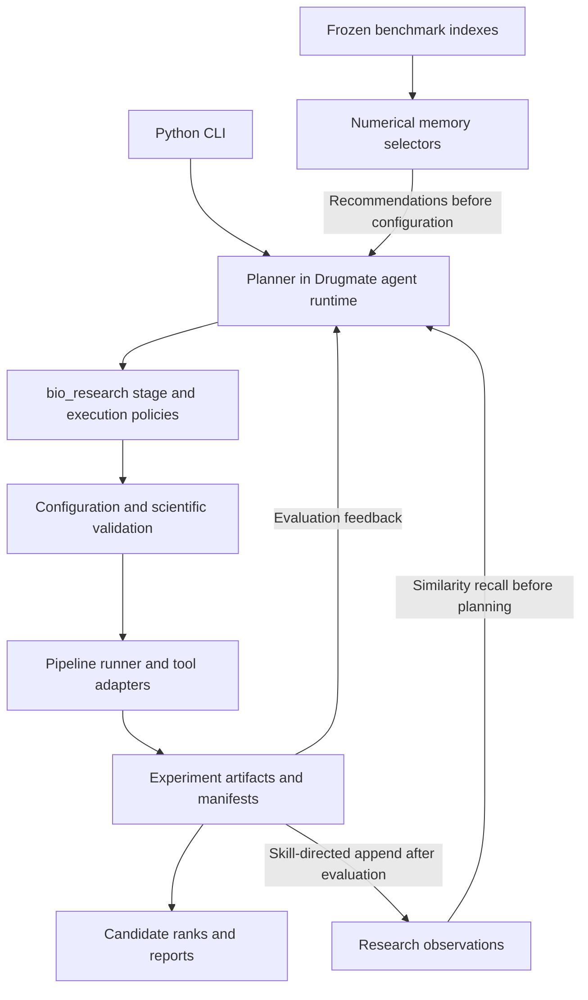

# Architecture and folder map

Drugmate retains its Hermes-derived agent runtime, SBDD workflow and Python CLI.
Its commands and shared Python modules use the Drugmate namespace; the scientific
skill keeps its established path.

The primary source entrypoint is `python drugmate --cli`, run from the checkout
root in the application Python environment. Setup and model configuration use
`python drugmate setup` and `python drugmate model`.
The Python package does not register a bare `drugmate` shell command.

The CLI invokes the agent directly. Model-provider authentication, persistent
sessions, per-conversation prompt caching, message ordering and scientific
confirmation tools remain in that execution path. Scientific completion and
lineage are recorded in pipeline artifacts. Generated HTML reports retain their
offline molecular viewers.

## Root inventory

The main entries below serve runtime, installation or source publication.
Not every entry is needed just to open the Python CLI. Scientific experiments
require their separately configured environments.

| Root entry | Purpose and reason for keeping it |
| --- | --- |
| `.gitattributes` | Portable script line endings in Git |
| `.gitignore` | Excludes local credentials, installed dependencies and generated state |
| `AGENTS.md` | Development scope, scientific constraints and cleanup instructions |
| `SOUL.md` | Fixed research persona, experiment boundaries and reporting requirements; the single source distributed with the runtime |
| `README.md` | Project overview, installation and CLI usage |
| `licenses/` | Original upstream MIT permission notice, copyright and third-party provenance records |
| `pyproject.toml` | Python dependencies, package discovery, entry modules and license metadata |
| `setup.py` | Collects scientific skill and memory asset files for Python installation |
| `MANIFEST.in` | Includes skills, translation data, documentation and notices in source distributions |
| `environment.yml` | Conda application environment with Python and pip |
| `drugmate` | Source launcher for `python drugmate --cli`, setup and management commands |
| `cli.py` | Interactive Python CLI |
| `run_agent.py` | Agent implementation used by the CLI |
| `drugmate_runtime/` | Shared tool dispatch, tool groups, paths, logging, sessions, time zones and utility modules |
| `agent/` | Model calls, prompt/message handling, live context compression and execution logic |
| `drugmate_cli/` | Commands, configuration, authentication and CLI startup |
| `providers/` | Fixed built-in model-provider adapters and settings |
| `tools/` | Core execution tools loaded by the agent |
| `locales/` | Translation catalogs read by approval prompts and CLI messages |
| `skills/` | Scientific pipeline, stage adapters, tool registry, policies and bundled reporting assets |
| `memory/` | Scientific query encoders and derived selector indexes; external weights and frozen releases are excluded |
| `docs/` | Scientific tool list, architecture, memory guidance and retained attribution |

Shared runtime modules live in `drugmate_runtime/`:

| Module within `drugmate_runtime/` | Responsibility |
| --- | --- |
| `model_tools.py` | Model-facing tool schemas and dispatch |
| `toolsets.py` | Terminal, file, skill, memory and scientific-confirmation tool groups |
| `drugmate_constants.py` | Runtime paths, environment resolution and shared constants |
| `drugmate_logging.py` | Logging and per-session context |
| `drugmate_state.py` | Conversation/session persistence |
| `drugmate_time.py` | Configured time zones for prompts, compression and timestamps |
| `utils.py` | URL, environment and atomic-file helpers |

The package initializer does not eagerly import these modules. Callers import
the required helper through `drugmate_runtime`, preserving its existing load
order. `cli.py` and `run_agent.py` remain at the root to retain their source-root
and entrypoint conventions.

Standard project files remain at the root so installation and workspace tools
can discover them: `pyproject.toml`, `setup.py`, `MANIFEST.in` and `environment.yml`.
The source release's copyright,
permission and provenance records are grouped under `licenses/` and are also
included in package metadata. Component-specific notices remain with their
respective source or bundled assets.

The persona loader reads the source checkout's `SOUL.md`, or the installed
copy under `share/drugmate/SOUL.md`. It does not select a persona from the current
working directory or a user's legacy home/profile copy. The fixed persona is
loaded when the agent's system prompt is built and remains stable for that
agent instance. Missing or empty shipped persona content is an error in normal
startup; the explicit `--ignore-rules` debugging mode still skips its injection.
`AGENTS.md` contains repository maintenance rules; scientific execution follows
`SOUL.md` and the pipeline protocol. The pipeline's English `SKILL.md` is the
canonical runtime entry and the documentation linked from the README.

The distributed `bio_research` skills are loaded from the active source checkout
or the complete installed scientific tree. Their shared modules and sibling
memory assets remain in the same layout. Old per-skill copies under
`DRUGMATE_HOME/skills/bio_research` are left on disk but do not override the
distributed category. Personal skills in other categories retain their normal
profile and external-directory lookup behavior.

Deployment settings live in the
[deployment reference](../skills/bio_research/pipeline-entry/references/deployment.md#local-deployment-file).
Configuration repair uses the runtime's `DEFAULT_CONFIG` directly. Live
conversation compression is implemented in `agent/context_compressor.py`.

The source release excludes the cron scheduler and its commands/API routes,
general web search/browser automation, social and multimedia tool plugins,
ACP/benchmark entrypoints, unrelated bundled skills, upstream installers,
TUI/WebUI/dashboard servers, test suites and test-only dependencies.
MCP clients/servers and the generic plugin framework are also excluded.
Model providers, local memory, file/terminal/process tools, delegation and
skill discovery remain supporting runtime integrations. They are used by the
CLI and are not replaced by SBDD-specific framework branches.

## Scientific stages

This implementation starts after a target/receptor is selected. Disease-to-target
prioritization through Open Targets is outside this release's scope.

The registry orders receptor preparation, pocket analysis, molecule sourcing/generation, property prefiltering, docking preparation and docking, pose evaluation, final property filtering, coordination, and reporting. Input normalization precedes the configured run when supplied formats require conversion. The agent explicitly selects the complete step/tool matrix and site/search-space strategy; the runner does not infer a scientific plan from a filename or fill omitted enable switches.

Receptor preparation establishes a geometric baseline. Final protonation, selected waters, and docking-format preparation belong to the docking preparation contract after prefiltering. See the [preparation contract](../skills/bio_research/pipeline-entry/references/preparation-contract.md) and [metric policy](../skills/bio_research/METRIC_POLICY.md).

## Source, state, and experiment storage

Installed dependencies and local state are excluded from the source release.
Virtual environments, caches and credentials are provisioned locally.

Drugmate stores configuration, secrets, conversation state, and logs under its selected `DRUGMATE_HOME`. The scientific workflow places configs, normalized inputs, tool outputs, caches, logs, and reports under the configured `SBDD_DATA_ROOT`, with separate allocated round directories. The default is `$HOME/drugmate-runs`; deployment overrides are documented in the [deployment reference](../skills/bio_research/pipeline-entry/references/deployment.md). This explicit skill policy is not a global path sandbox implemented by the runner.

Bundled molecular-viewer assets and licenses are retained for offline reports and structure visualization. The selected scientific memory indexes and query-encoding source are under `memory/`; model weights, external tool installations, complete frozen releases and experiment outputs are provisioned separately.
